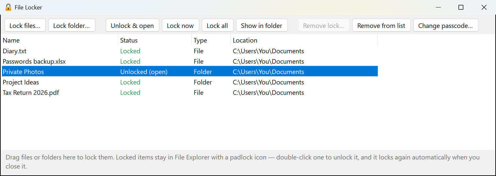
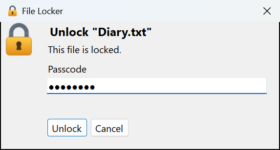
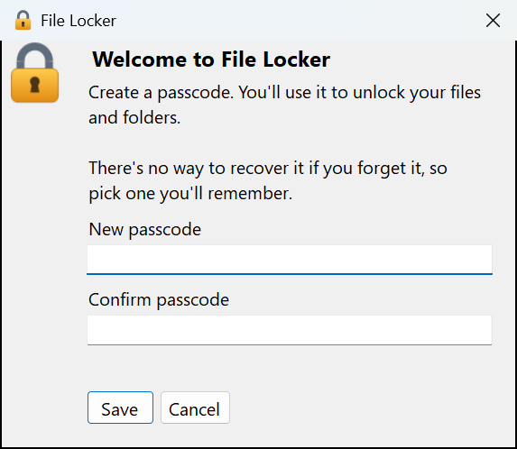

# File Locker

Lock files and folders with a passcode. Locked items stay visible in File Explorer
(as `Name.locked` with a padlock icon). Double-click one to enter your passcode and open it, and it
locks itself again as soon as you close it.



Double-clicking a locked item in File Explorer asks for your passcode:



On first launch you choose your passcode:



## Download

Get `FileLocker.exe` from the [latest release](https://github.com/ZDStudios/File-Folder-Locker/releases/latest).
It needs the [.NET 8 Desktop Runtime](https://dotnet.microsoft.com/download/dotnet/8.0) (Windows x64).

## Run it

`dist\FileLocker.exe`. On first launch you create your passcode. Launching it also registers
`.locked` files with File Explorer for your Windows user, so no admin rights are needed.
If you move the exe, run it once from its new location to re-register.

To rebuild:

```
dotnet publish -c Release -r win-x64 --self-contained false -p:PublishSingleFile=true -o dist
```

## How it works

- **Lock**: the item is encrypted (AES-256-GCM, key from your passcode via PBKDF2-SHA256)
  into `Name.locked`, and the original is deleted. Folders are zipped first.
- **Open**: double-click the `.locked` item, or use *Unlock & open* in the app. A decrypted copy
  goes into `%TEMP%\FileLocker\Open` (outside OneDrive) and opens in its normal app. Folders open
  in the same Explorer window, so pressing Back leaves them.
- **Auto-lock**: while it's open, a padlock sits in the taskbar tray. When no program or Explorer
  window is showing the item any more, any changes are encrypted back into the `.locked` file and
  the decrypted copy is deleted.
- **Manual lock**: *Lock now* / *Lock all* in the app, or right-click the tray padlock → *Lock now*.
- **Remove lock** turns an item back into a normal file or folder.

## Things to know

- A forgotten passcode can't be recovered.
- OneDrive keeps **version history** and a recycle bin. Locking a file that was already
  synced doesn't remove the older unencrypted copies from OneDrive's history.
- Auto-lock watches for open windows and file handles. If an app gives no sign it's showing the item,
  File Locker tells you after 20 seconds and waits for you to lock it from the tray.
